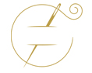

<div align="center">

  

  # 🧵 HUTZAHAV ATELIER HAUTE COUTURE
  ### חוט זהב • Авторское ателье высокой моды Галины Хвостенко
  ### 📍 Shavei Tzion 2, Ashdod, Israel (Ашдод, Шавей Цион 2)

  <p align="center">
    <strong>Премиальное веб-пространство авторского ателье индивидуального пошива, ручной росписи по шёлку и льну, нуно-войлока, реставрации брендовой одежды и интерьерного текстиля.</strong>
  </p>

  <p align="center">
    <a href="https://wa.me/972585877708"></a>
    <a href="https://t.me/+972585877708"></a>
    <a href="mailto:galahvost74@gmail.com"></a>
    <a href="https://www.google.com/maps/search/?api=1&query=Shavei+Tzion+2,+Ashdod"></a>
  </p>

  <p align="center">
    <a href="https://www.instagram.com/hutzahav.atelier/"></a>
    <a href="https://www.facebook.com/hutzahav"></a>
    <a href="https://easy.co.il/en/page/10090491"></a>
    
  </p>

---

</div>

## ⚜️ О бренде «HUTZAHAV» (חוט זהב)

**«Хут Захав»** в переводе с иврита означает **«Золотая Нить»**. 

Ателье расположено в **Ашдоде** по адресу **ул. Шавей Цион 2 (Shavei Tzion 2, Ashdod)** и основано в **2019 году** кутюрье и художником по текстилю **Галиной Хвостенко**, посвятившей искусству индивидуального кроя и живописи по ткани более **15 лет**.

> *«Мы искренне любим свое дело и ценим наших клиентов. Вместе мы создаем стиль, подчеркивающий уникальность каждой личности.»*  
> — **Галина Хвостенко**

### Ключевые направления ателье:
1. **Вечерний & Свадебный Haute Couture** — индивидуальное моделирование корсетов, работа с деликатными тканями (натуральный шелк, шифон, французское кружево, тафта, бархат) по 25 анатомическим меркам.
2. **Дизайнерская одежда с ручной росписью** — авторская живопись специальными несмываемыми пигментами по 100% умягченному льну и натуральному шелку.
3. **Арт-деним & Нуно-войлок (Валяние)** — авторские жакеты и пальто, инкрустированные тонкорунной шерстью австралийского мериноса (18 микрон) и шелковыми волокнами.
4. **Премиум реставрация & Подгонка по фигуре** — посадка брендовых костюмов и платьев с точностью до миллиметра, реставрация кожи, дубленок, обуви и сумок.
5. **Домашний текстиль & Шторы** — пошив штор по индивидуальным размерам, авторское постельное белье из сатина и льна нестандартных размеров, покрывала.

---

## ✨ Особенности веб-пространства Ателье

### 1. Интерактивная карта Google Maps & Геолокация
* Встроенная интерактивная карта с геолокацией ателье по адресу: **Shavei Tzion 2, Ashdod (רחוב שבי ציון 2, אשדוד)**.
* Кнопки прямого перехода:
  * 📍 **Google Maps** (прокладка маршрута)
  * 🚗 **Waze** (навигация для водителей)
  * 🔖 **Easy.co.il** (профиль ателье в каталоге Израиля)

### 2. Прямая связь по всем каналам
* 🟢 **WhatsApp**: `https://wa.me/972585877708`
* 🔵 **Telegram**: `https://t.me/+972585877708`
* ✉️ **Email**: `galahvost74@gmail.com` с возможностью моментальной отправки через почтовый клиент
* 📞 **Телефон**: `+972 58-587-7708`

### 3. Интерактивный калькулятор пошива и примерки (`BespokeCalculator`)
* Расчет стоимости в реальном времени с учетом ткани, кутюрных техник (корсет, роспись, валяние) и срочности.
* Запись на примерку в WhatsApp с автоматически подставленным расчетом.

### 4. Онлайн-бутик без оплаты (Direct Inquiry Boutique)
* 🛍️ **Корзина заказа (`CartDrawer`)**: Добавление изделий с выбором размера или опцией «Индивидуальный пошив».
* 💌 **Оформление в 1 клик**: Формирование структурированного заказа с мерками и пожеланиями напрямую в **WhatsApp**, **Telegram** или на почту `galahvost74@gmail.com`.
* 💖 **Список желаний (`WishlistDrawer`)**: Сохранение понравившихся моделей и отправка персонального вишлиста мастеру.
* 📐 **Гид по размерам (`SizeGuideModal`)**: Таблица соответствия (Израиль/EU, US, UK, RU) и подробная иллюстрированная инструкция по снятию мерок (ОГ, ОТ, ОБ).
* 🌿 **Гид по тканям & уходу (`FabricGuideModal`)**: Описание авторских техник нуно-войлока, 100% итальянского льна stonewash и натурального шелка с памяткой по уходу.
* 🎁 **Подарочные сертификаты (`GiftCertificates`)**: Интерактивный конструктор именных кутюрных сертификатов (300 ₪, 500 ₪, 1000 ₪, 2000 ₪) с мгновенным заказом.
* ❓ **Бутик-FAQ (`BoutiqueFAQ`)**: Интерактивный аккордеон с ответами на частые вопросы (дистанционный пошив, примерка в Ашдоде, доставка по Израилю и миру).

### 5. Трехъязычный интерфейс (Русский / English / עברית) & Полная поддержка RTL
* 🌐 **Мгновенное переключение языка**: в хедере и мобильном меню доступны **РУС** (по умолчанию), **ENG** (для международных клиентов) и **עברית** (для жителей Израиля).
* 🔄 **RTL (Right-to-Left)**: при переключении на иврит страница автоматически применяет `dir="rtl"`, переориентируя выравнивание текста, стрелки, бейджи и кнопки.
* 📝 **Полный перевод всех модулей**: Hero, услуги ателье, калькулятор, каталог, сертификаты, FAQ, контакты и футер.

### 6. Кнопка доступности для людей с инвалидностью (Accessibility / נגישות)
* Полноценное меню специальных возможностей: увеличение шрифта, высокая контрастность, монохром, системный шрифт без засечек (для дислексии), подсветка ссылок и остановка анимаций.

---

## 🛠️ Технологический стек

| Слой | Технологии |
|---|---|
| **Frontend Framework** | [React 18](https://react.dev/) + [TypeScript](https://www.typescriptlang.org/) |
| **Сборщик & Dev Server** | [Vite 6](https://vitejs.dev/) |
| **Стилизация** | [Tailwind CSS 3.4](https://tailwindcss.com/) + PostCSS + Autoprefixer |
| **Иконки** | [Lucide React](https://lucide.dev/) + кастомные векторные SVG |
| **Картография** | Google Maps Embed API + Waze Deep Links + Easy.co.il |
| **Типографика** | Google Fonts: `Cinzel`, `Cormorant Garamond`, `Inter` |

---

## 🚀 Запуск и сборка

```bash
# Установка зависимостей
npm install

# Запуск сервера разработки
npm run dev

# Сборка для продакшена
npm run build
```

---

## 📞 Контакты Студии «HUTZAHAV»

* 👑 **Кутюрье:** Галина Хвостенко
* 📍 **Адрес:** Израиль, г. Ашдод, ул. Шавей Цион 2 (Shavei Tzion 2, Ashdod)
* 📱 **Телефон / WhatsApp:** [+972 58-587-7708](tel:972585877708) | [WhatsApp Chat](https://wa.me/972585877708)
* 💬 **Telegram:** [t.me/+972585877708](https://t.me/+972585877708)
* ✉️ **Email:** [galahvost74@gmail.com](mailto:galahvost74@gmail.com)
* 📸 **Instagram:** [@hutzahav.atelier](https://www.instagram.com/hutzahav.atelier/)
* 📘 **Facebook:** [hutzahav](https://www.facebook.com/hutzahav)
* 🌐 **Easy.co.il:** [Hutzahav Sewing Workshop](https://easy.co.il/en/page/10090491)

---

<div align="center">
  <sub>Создано с любовью к кутюрному мастерству 🧵✨</sub><br>
  <sub>© 2019–2026 HUTZAHAV ATELIER • SHAVEI TZION 2, ASHDOD. All rights reserved.</sub>
</div>
